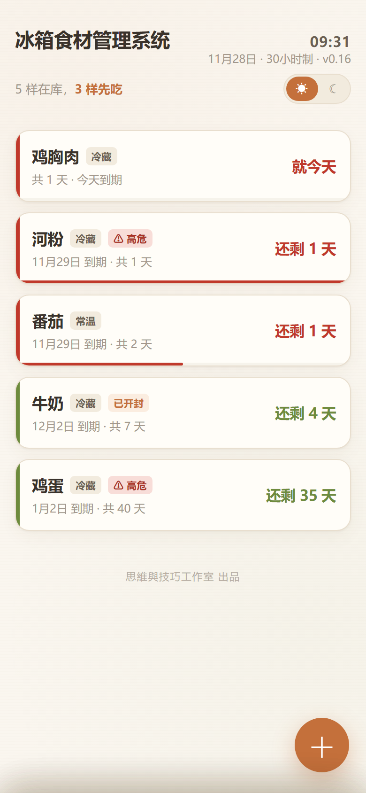
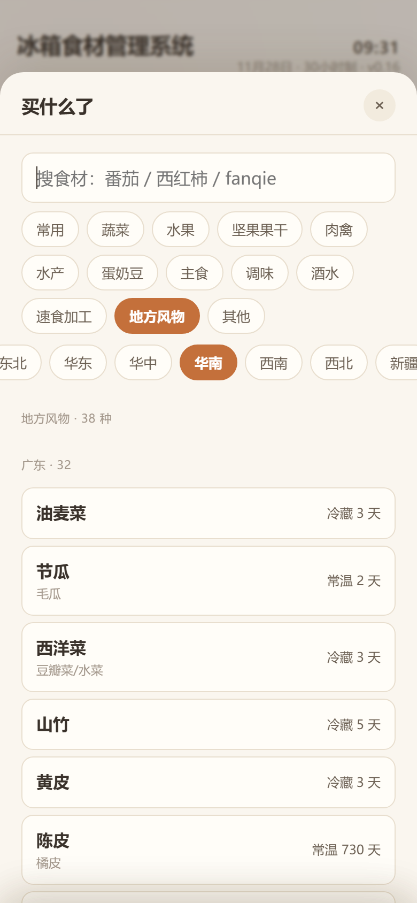
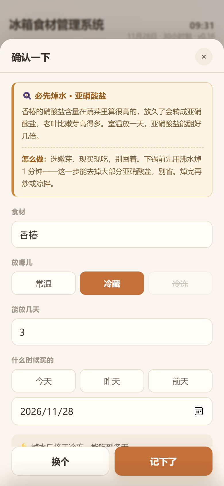
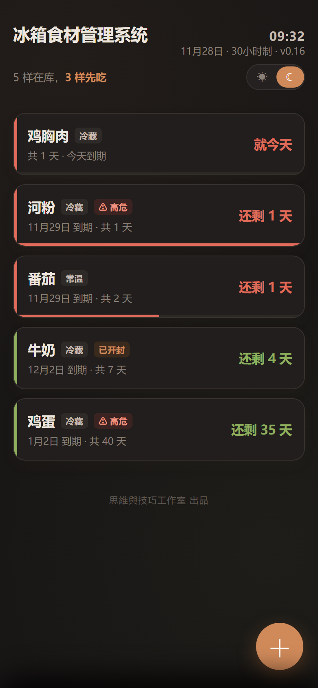

<div align="center">

# 冰箱食材管理系统

**记录冰箱里有什么，按「该先吃」从上到下排好。**



<br>


**→ [meng-tang-trans.github.io/fridge-food-manager](https://meng-tang-trans.github.io/fridge-food-manager/) ←**

</div>

---

## 它是怎么想的

大部分食材管理 App 死在两个地方：录入太慢，和排序不可信。

这个只有一条主线：**买回来 → 记下来 → 按紧急度从下往上吃**。没有账号，没有云同步，没有弹窗，断网也能用——打开就是一张清单。

<table>
<tr>
<td align="center" width="33%">
<br>
<sub><b>两条平行的浏览轴</b><br>分类 × 地域，每条食材标省份与时令</sub>
</td>
<td align="center" width="33%">
<br>
<sub><b>七层安全提示</b><br>从「不记录」到「别吃太多」，语气分明</sub>
</td>
<td align="center" width="33%">
<br>
<sub><b>三挡主题</b><br>浅色 / 黑夜 / 粉色，滑块切换</sub>
</td>
</tr>
</table>

## 排序规则

这是整个应用唯一重要的事。

| 优先级 | 条件 | 规则 |
|:---:|---|---|
| 1 | 已过期 | 过期最久的在最上，红色 |
| 2 | 剩余 ≤ 2 天 | 剩余少的在前 |
| 3 | 其余 | 剩余 ÷ 总天数 升序 |

颜色只是把数字说了一遍：**过期或剩 1 天红**，剩 2–3 天橙，比例低于 40% 黄，其余绿。进度条只在快到期时才出现，不让整屏都是红条。

## 30 小时制

一天的切换点在早上 6 点，不是 0 点。凌晨两点你还醒着，看的仍然是「昨天」的清单。

| 维度 | 规则 |
|---|---|
| 时钟 | 凌晨 0–6 点显示为 `24:00–29:59` |
| 记账 | 凌晨吃掉/扔掉的记在前一天 |
| 买入 | 按日历日记，「还剩 X 天」也跟着日历日走 |

第三条是为了避免出现「还剩 4 天 / 共 3 天」这种自相矛盾的数字。

## 七层安全提示

不是所有风险都该用同一种语气说话。

| 层 | 颜色 | 处理 | 例子 |
|:---:|:---:|---|---|
| 野味 | 深红 🚫 | **不记录**，讲法律与检疫 | 果子狸、穿山甲 |
| 不文明食材 | 米色 🕊 | **不记录**，给替代方案 | 狗肉、鱼翅、发菜 |
| 高危 | 红 ⚠ | 照记，每次警告 | 河粉（米酵菌酸）、自榨油、虹鳟 |
| 处理风险 | 蓝灰 🧤 | 照记，提醒防护 | 虾枪、蟹钳、壳边（海洋创伤弧菌） |
| 必须烧熟 | 琥珀 🍳 | 照记，提醒做熟 | 猪肉绦虫、沙门氏菌、草酸、亚硝酸盐 |
| 戒酒 | 暗紫 🍷 | 照记，克制提醒 | 啤酒、白酒、清酒 |
| 别吃太多 | 橄榄绿 🥢 | 照记，给具体用量 | 加工肉、内脏、含糖饮料、荔枝 |

前两层**不帮你记**——河粉你确实会买会存，需要的是正确处置；狗肉不是「怎么存」的问题。

## 食材库

**498 种**，11 个大类、16 个细类。每条包含：

- 常温 / 冷藏 / 冷冻三档天数，取保守值（算到「开始不对劲」，不是「已经坏了」）
- 别名与拼音（「西红柿」「xihongshi」都能搜到番茄）
- 所属地域与省份、时令月份

地方风物单列一类，覆盖华北、东北、华东、华中、华南、西南、西北、新疆、港澳台，共 159 条带省份信息。

## 快速开始

不需要安装，**直接双击 `index.html`** 就能用。

想在手机上访问，起一个静态服务：

```bash
python -m http.server 8899
```

手机浏览器打开 `http://<电脑局域网IP>:8899`。

## 目录

```
index.html        界面与全部交互逻辑
foods.js          食材库 + 风险规则 + 地域与时令
check-foods.py    数据校验脚本
docs/             截图
```

## 改数据

改完 `foods.js` 跑一次：

```bash
python check-foods.py
```

它会检查：参数错位、ID 重复、拼音缺字、映射表引用了不存在的 ID、分类兜底失败。

## 技术

纯静态单页，没有框架、没有构建、没有依赖。数据存在浏览器 `localStorage`，换设备用「导出 / 导入」备份。

---

<div align="center">

**「赏味期」是参考值，不是保质期，不构成食品安全建议。**
肉类、乳制品、水产请自行判断；身体不适请及时就医。

<sub>思維與技巧工作室 出品</sub>

</div>
